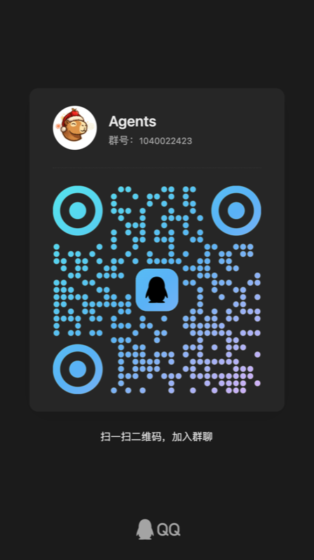

# Astra Pet

一只住在桌面上的宠物：会走动、会回应点击和摸头，可以接入大模型陪你聊天，也会提醒你喝水、起身活动。用 [Avalonia](https://avaloniaui.net/) 写成，支持 macOS 和 Windows，可以编成 Native AOT。

下载：<https://hub.astra-gate.si/download>　源码：<https://github.com/239573049/Astra-Pet>

## 交流群

QQ 群「Agents」，群号 **1040022423**，扫码加入：

<p align="center">
  
</p>

## 许可 / License

> **源码开源（MIT），宠物形象的版权归 RoutinAI。 / Source code is open source (MIT); the pet artwork is copyrighted by RoutinAI.**

| 内容 / What | 许可 / License | 文件 / File |
|---|---|---|
| 程序源码 / Source code | **MIT** © 2026 RoutinAI | [LICENSE](LICENSE) |
| 宠物形象、动画、角色设定等素材 / Pet characters, animations, artwork（`src/Assets/pets/xiaot.astrapet`、`src/Assets/icons/`、`characters/小t/`、`astra/`） | **© 2026 RoutinAI，保留所有权利 / All rights reserved**，只能按素材许可使用 | [LICENSE-ASSETS.md](LICENSE-ASSETS.md) |
| 内置角色「大肥鱼」/ Built-in character "Dafeiyu"（`src/Assets/pets/dafeiyu.astrapet`） | **CC BY-NC-SA 4.0**，不属于 RoutinAI，禁止商用。形象：B 站 @上善无形（原型「溟月」）、@ZipZipPipe（DeepSeek 版设计）；动画：[dsh-pet](https://github.com/PC2005-cloud/dsh-pet)。社区二创形象，非 DeepSeek 官方 / not owned by RoutinAI, non-commercial, community fan character, not official DeepSeek | [LICENSE-ASSETS.md](LICENSE-ASSETS.md) 第 2 节 |
| 第三方库、数据、随包分发的 FFmpeg / Third-party libraries, data, bundled FFmpeg | 各自的许可 / their own licenses | [THIRD_PARTY_NOTICES.md](THIRD_PARTY_NOTICES.md) |

要点：你可以自由使用、修改、发布这份**代码**；但**不能**把宠物素材拿去单独使用、修改、商用或再分发，也不能把它们打进你自己的发布包。想发布自己的版本，请换成你自己的角色（见 [LICENSE-ASSETS.md](LICENSE-ASSETS.md) 第 5 节）。

In short: you may freely use, modify and publish the **code**; you may **not** use the pet assets on their own, modify, commercialise or redistribute them, or ship them inside your own builds. To publish your own version, swap in your own character (see section 5 of [LICENSE-ASSETS.md](LICENSE-ASSETS.md)).

## 从源码构建

需要 .NET 10 SDK 和 ffmpeg（要带 `libvpx-vp9` 解码器：宠物动画是带透明通道的 VP9 WebM，ffmpeg 自带的 VP9 解码器会丢掉透明通道）。**官方发布包已经自带**一个精简的 LGPL 版 ffmpeg，直接用就行；从源码运行时用系统里的（`brew install ffmpeg`）或者自己构建一份（`tools/ffmpeg/build.sh`）。

```bash
dotnet run --project src/AstraPet.App     # 开发运行
dotnet test                              # 单元测试
```

素材目录和 ffmpeg 的查找顺序：

- 角色：内置角色包在程序目录下的 `Assets/pets/*.astrapet`（小t 是默认角色，另有大肥鱼），用户的角色放在数据目录的 `characters/` 下（角色包或素材文件夹）。开发时可以用环境变量 `ASTRA_PET_VIDEOS` 指向一个素材目录，代替默认角色。内置角色包用 `tools/pets/build.sh` 重新生成。
- ffmpeg：环境变量 `FFMPEG`，其次是程序旁边的 `ffmpeg`（Windows 是 `ffmpeg.exe`，官方发布包里就是这个），再其次是系统里的 ffmpeg。

### Native AOT

```bash
dotnet build   src/AstraPet.App/AstraPet.App.csproj -c Release -r osx-arm64 -p:PublishAot=true
dotnet publish src/AstraPet.App/AstraPet.App.csproj -c Release -r osx-arm64 -p:PublishAot=true --no-build -o publish
./publish/AstraPet --smoke      # 冒烟自测，输出 "smoke ok" 才算正常
```

必须**先 build 再 `publish --no-build`**：开着 AOT 时直接 `dotnet publish` 会让 Avalonia 跳过 XAML 编译，程序一启动就报 “No precompiled XAML found”。`-r` 换成 `osx-x64`、`win-x64` 就是别的平台。

### 发布

给仓库打 `v*` 标签（例如 `v0.2.0`、`v0.3.0-preview.1`），GitHub 工作流 `.github/workflows/release.yml` 会构建各平台的安装包并上传到 Astra Hub（<https://hub.astra-gate.si/download>）：

| 平台 | 安装包 | 说明 |
|---|---|---|
| macOS（Apple 芯片、Intel） | `.dmg` | Developer ID 签名；配了公证凭据就公证并钉票据 |
| Windows x64 | `.exe` 安装程序（Inno Setup） | 装到当前用户目录，不需要管理员权限；没有代码签名 |
| Linux x64 | `.deb`（Debian / Ubuntu） | 实验性：开机自启、朗读、点击穿透、听歌检测暂不支持 |

三个平台的包都自带精简的 LGPL 版 ffmpeg。需要在仓库 Secrets 里配置 `HUB_RELEASE_TOKEN`（上传到 Astra Hub，和站点的 `Releases__UploadToken` 一致）和 `MACOS_CERT_P12_BASE64`、`MACOS_CERT_PASSWORD`（macOS 签名）。

应用图标由 `python3 tools/icon/make_icons.py` 从角色立绘生成（`.icns` 只能在 macOS 上生成，生成后提交到仓库）。

## 目录

```
src/            程序源码，按层拆成几个项目（设计见 design/）：
  AstraPet.Core/            领域模型、设置、动画状态机、更新检测；只依赖 BCL
  AstraPet.Infrastructure/  大模型客户端、从其他应用导入提供商、下载更新
  AstraPet.Platform/        与操作系统有关的一切（macOS / Windows / Linux 各自实现）
  AstraPet.App/             Avalonia 界面和启动代码，唯一引用 Avalonia 的项目
  Assets/                   宠物动画、图标、模型库（各项目共用，见上面的许可表）
tests/          单元测试
design/         架构设计和重构计划
characters/     宠物角色（素材，见上面的许可表）
installer/      Windows 安装程序脚本（Inno Setup）
tools/          素材生成（petgen）、ffmpeg 构建、打包（dmg / deb / 公证）、图标、第三方声明生成等脚本
licenses/       随包分发的第三方许可证全文
```
